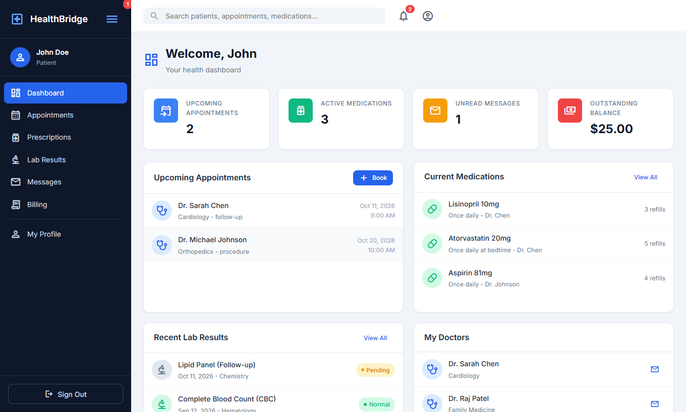
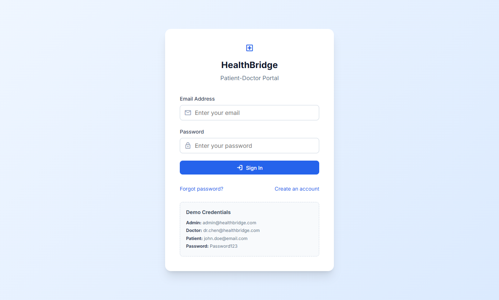
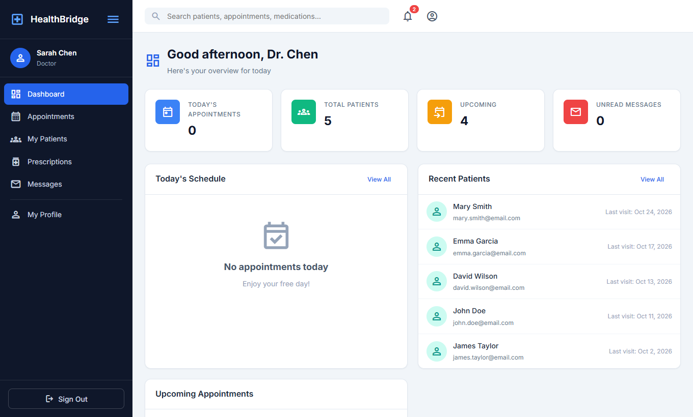
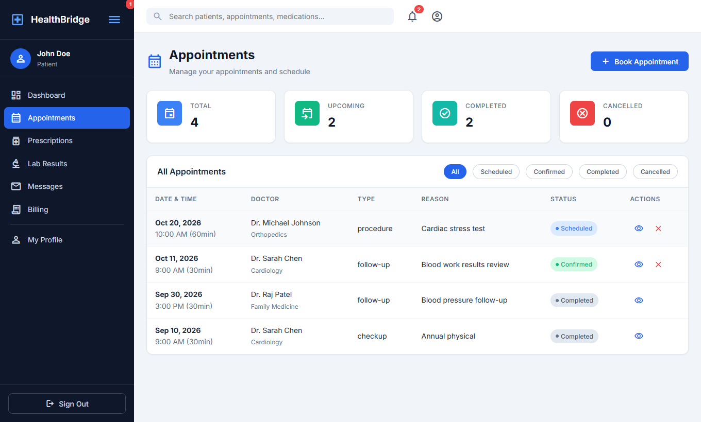
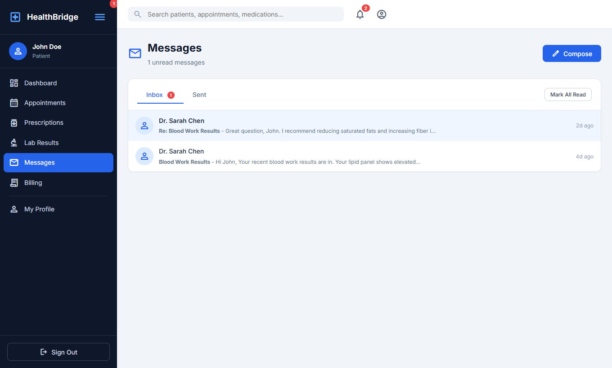
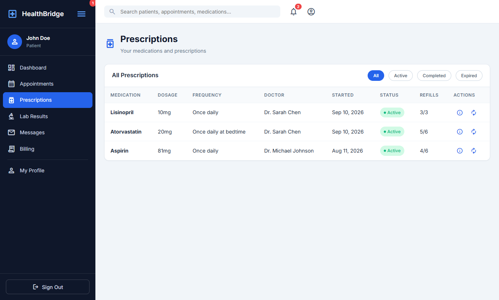
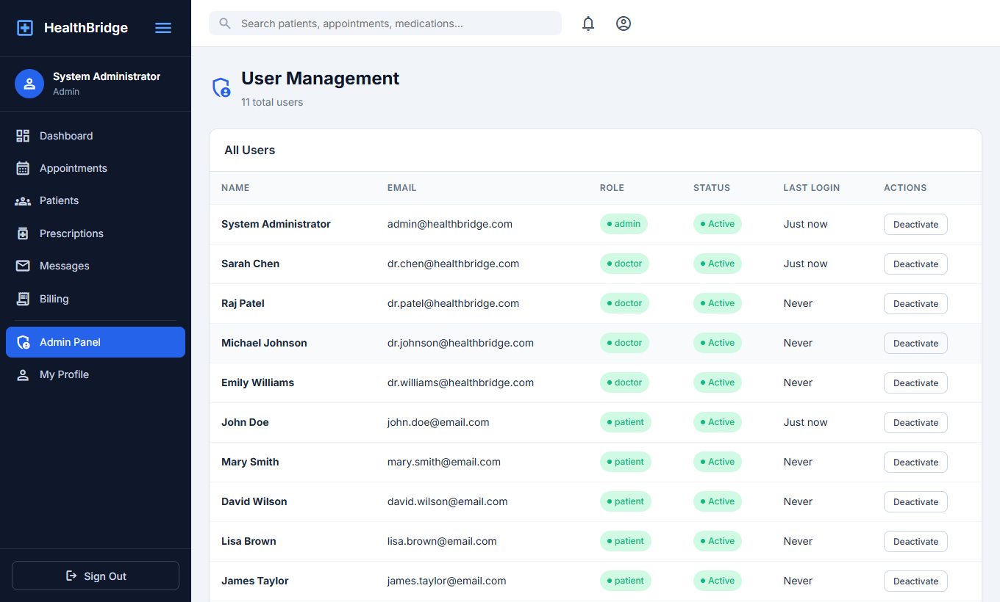
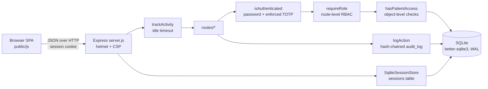

# HealthBridge: Doctor-Patient Portal

[](https://github.com/AwpDemon/doctor-patient-portal/actions/workflows/ci.yml)
[](LICENSE)


**A UGA MIST 4610 group project (Spring 2025).** This is a full-stack patient portal (Node, Express, SQLite,
vanilla-JS SPA) with role-based access for patients, doctors, and admins. It runs on fictional seed data
only. **It is a class project, not a production or HIPAA-compliant system.** It does implement and test
the technical controls HIPAA's Security Rule asks about, and [docs/CONTROL_MAPPING.md](docs/CONTROL_MAPPING.md)
maps each one to NIST SP 800-53 and 45 CFR 164.312, including what is still missing.

## Results at a glance

| | |
|---|---|
| API surface | **59 REST endpoints** (auth 12, messages 11, appointments 10, dashboard/admin 9, patients 8, prescriptions 7, plus `/api/health` and `/api/doctors`) |
| Tests | **55 Jest/Supertest tests, all passing**: 21 auth-flow tests and 34 security/access-control tests |
| Security self-assessment | **19 control gaps found and fixed in code** (Oct 2026), 18 with a dedicated test and 1 enforced in CI. Run against the original code, 29 of the 34 security tests fail. |
| Audit logging | 36 event types, including PHI reads; SHA-256 hash-chained, append-only table with a verifier |
| Dependencies | `npm audit --omit=dev`: **0 advisories** (was 2 critical / 9 high before the fixes), gated in CI |

Examples of what the assessment caught and fixed (full list with evidence links in the
[control mapping](docs/CONTROL_MAPPING.md#1-gaps-found-and-fixed-in-this-assessment)):

- **MFA bypass.** The "2FA verified" check existed but was never applied. A password alone gave a 2FA user
  full API access.
- **Broken object-level authorization.** Any doctor could read any patient's lab results and billing, and
  any user could read any message thread by id.
- **Session timeout that never fired.** The code refreshed the "last activity" timestamp *before* checking it.
- **Reset tokens valid after expiry.** An ISO-vs-SQLite date-string comparison let an expired token work
  until midnight.



## Screens

Real captures of the running app ([`docs/capture_screenshots.js`](docs/capture_screenshots.js), Playwright + Chrome).

| Login | Doctor dashboard |
|:---:|:---:|
|  |  |

| Appointments (patient) | Secure messaging |
|:---:|:---:|
|  |  |

| Prescriptions (patient) | Admin: user management |
|:---:|:---:|
|  |  |

## Architecture



A request passes three gates before it reaches patient data: an authenticated, fully MFA'd session; a
role allowed on that route; and, for patient-scoped data, an access relationship (admin: all; patient:
self; doctor: patients they have an appointment with). Security-relevant actions and denials go to the
audit log.

## Quick start

```bash
git clone https://github.com/AwpDemon/doctor-patient-portal.git && cd doctor-patient-portal
npm ci
cp .env.example .env        # set SESSION_SECRET
npm run seed                # fictional demo clinic
npm run dev                 # http://localhost:3000
```

Demo accounts (password `Password123`): `admin@healthbridge.com`, `dr.chen@healthbridge.com`,
`dr.patel@healthbridge.com`, `john.doe@email.com`, `mary.smith@email.com`, `david.wilson@email.com`.
All people and records in the seed are fictional.

## Features

**Security**
- bcrypt password hashing (cost 12); per-account lockout after 5 failures; per-IP rate limit on login and password reset
- TOTP two-factor authentication (RFC 6238, works with Google Authenticator), enforced on every API call once enabled
- Session ID regenerated at login; 30-minute idle timeout; 24-hour absolute lifetime; `HttpOnly`/`SameSite` cookies
- Role-based access control (patient / doctor / admin) plus per-patient access checks
- Self-registered doctor accounts held for admin approval
- Password reset with single-use, 1-hour, hashed tokens
- Hash-chained, append-only audit log with an admin viewer and a chain verifier
- helmet security headers including a Content-Security-Policy

**Clinical / product (11 UI modules):** dashboard, patient records, appointment scheduling with slot
availability, threaded secure messaging, prescriptions and refill requests, billing, lab results with
reference ranges, profile, notifications, global search, admin panel.

## Testing

```bash
npm test            # 55 tests (tests/auth.test.js, tests/security.test.js)
npm audit --omit=dev
```

`tests/security.test.js` is organized by NIST control (IA-2(1), AC-12, SC-23, AC-7, AC-2, IA-5, AC-3/AC-6,
AU-9, SC-18), and each test is cited from the control mapping. CI runs the suite, a production-dependency
audit, and a boot + `/api/health` smoke test on every push.

## Limitations

This is not production software. The main gaps are listed in the
[control mapping](docs/CONTROL_MAPPING.md#remaining-gaps): no TLS termination in the repo, no encryption of PHI
at rest, MFA optional rather than required for clinicians, no external anchor for the audit hash chain, no
emergency-access procedure, CSRF protection that relies on `SameSite` cookies, and an in-memory IP rate
limiter. The administrative and physical safeguards HIPAA requires are out of scope for a code repository.

## Project context and authorship

HealthBridge started as a group project for UGA MIST 4610 in Spring 2025. I published this repository in
2026 from that coursework, so its commit history shows the upload and my later work, not the team's
original development history. The October 2026 security assessment, the fixes, the 34 security tests, and
the control mapping are my own post-course work.

## Tech stack

Node 20, Express 4, better-sqlite3 (WAL), express-session (custom SQLite store), bcryptjs, speakeasy,
helmet, express-validator, Jest + Supertest, GitHub Actions.

## License

MIT. See [`LICENSE`](LICENSE).
